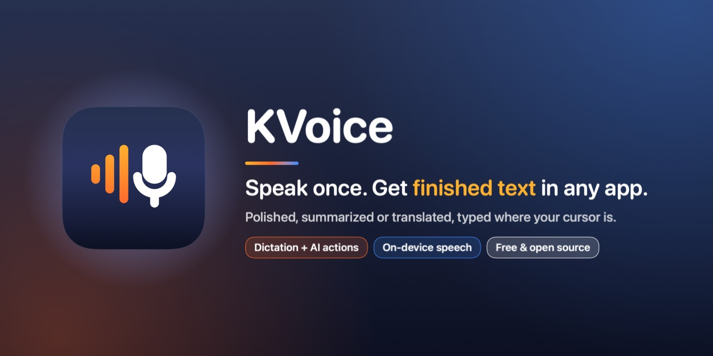
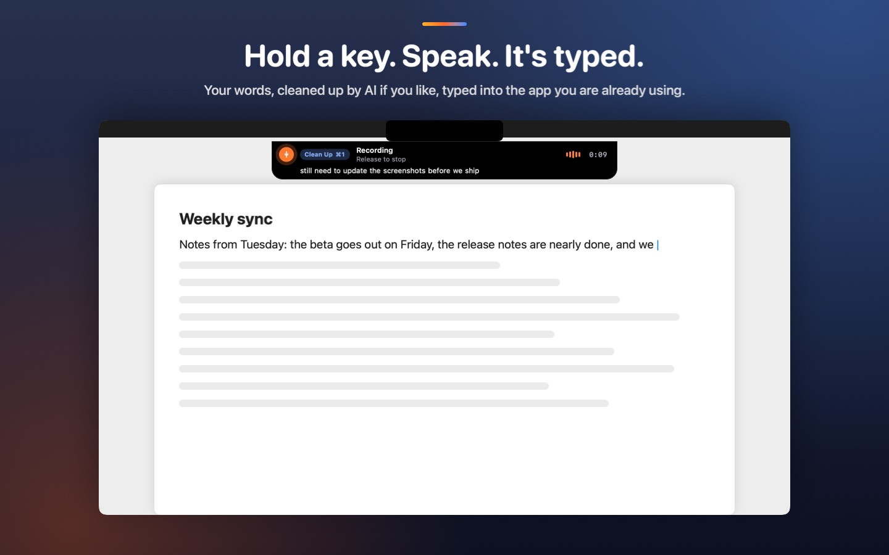
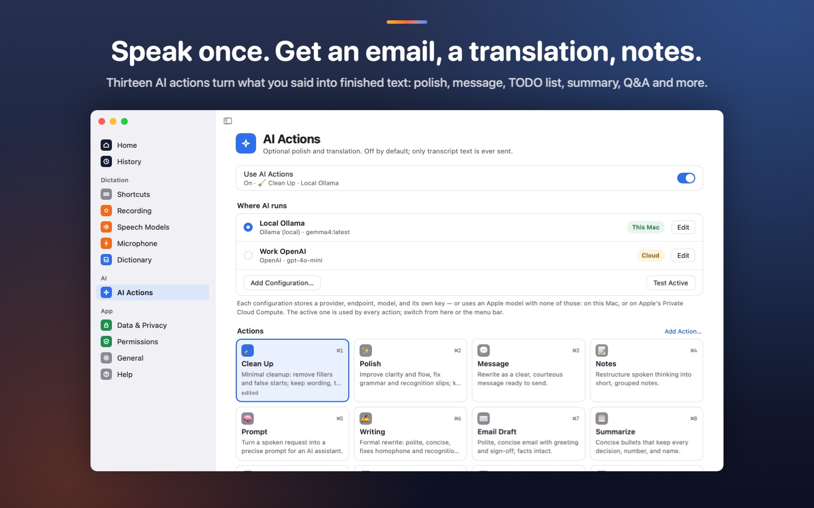
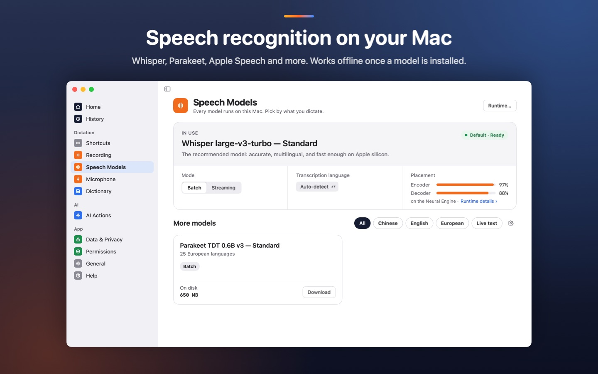
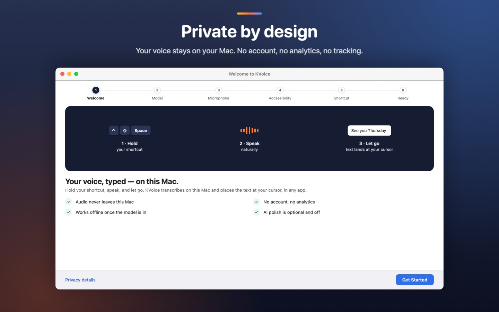

<p align="center"><a href="README.md">English</a> · <b>简体中文</b></p>

<p align="center">
  
</p>

<h3 align="center">说一次，成稿直接打在你正在用的地方。</h3>

<p align="center">
  
  <a href="https://github.com/kccarlos/kvoice/releases/latest"></a>
  <a href="LICENSE"></a>
  
  
  
  <a href="https://github.com/kccarlos/kvoice/stargazers"></a>
</p>

<p align="center">
  <a href="https://github.com/kccarlos/kvoice"><b>⭐ 在 GitHub 上点个 Star</b></a>
  ，第一时间收到新版本。免费，也能帮更多 Mac 用户找到 KVoice。
</p>

<!--
  Demo slot: the same GIF and recording link as README.md, at the same place.
-->

**语音输入和 AI 操作，一步完成。** 按住快捷键，说话，松开，KVoice
就把成稿打在光标所在的位置：可以是整理干净的原话，也可以是润色后的文字、
一封邮件、一条消息、会议笔记、待办清单、摘要、回答或译文。任何 Mac 应用都能用
（邮件草稿、聊天框、文档、终端），而且语音识别**在你的 Mac 上**完成。

- 随口讲讲会议内容 → 一封清楚、得体的**邮件草稿**。
- 说中文 → 得到**英文文字**（语言对可以自己设）。
- 聊聊这周要做的事 → 一份能直接执行的**待办清单**。

只想要普通的语音输入？也可以，完全不用 AI。

界面支持**简体中文**：默认跟随系统语言，也可以在“设置 › 通用 › 界面语言”里切换。

### 安装

```sh
brew install --cask kccarlos/tap/kvoice
```

也可以[下载经过公证的 DMG](https://github.com/kccarlos/kvoice/releases/latest)，
把 KVoice 拖进“应用程序”。需要 Apple 芯片的 Mac 和 macOS 15 或更高版本。
Mac App Store 版即将上架，两个版本的区别见[下载](#下载)。

<p align="center">
  
</p>

## 为什么选 KVoice

- **从语音到成稿，一步到位。** 内置十三个 AI 操作：Clean Up、Polish、Message、Notes、
  Prompt、Writing、Email Draft、Summarize、TODO List、Q&A、Terminal、
  Translate 和 Translate 2。都可以修改，也可以自己写新的。
- **任何应用都能用。** 结果直接进入你正在用的应用，而不是先出现在 KVoice
  的窗口里再让你复制。
- **AI 引擎由你选。** **本机 Apple 智能**（macOS 26 或更高版本：不用账号、
  不用密钥，数据不离开这台 Mac），或任何兼容 OpenAI 的服务，填自己的密钥即可，
  包括用 Ollama 跑在自己电脑上的模型。
- **私密的本机转写。** 语音识别在 Mac 的神经网络引擎上运行，音频从不上传。
  只有在你打开 AI 时才会调用 AI，而且只用你选的引擎。
- **又快又准的本地模型。** 默认 Whisper large-v3-turbo（支持约一百种语言），
  另有 Parakeet、Nemotron、SenseVoice 和 Paraformer，以及 macOS 26
  及更高版本自带的识别器 **Apple Speech**。
- **免费开源。** MIT 许可证。没有订阅，没有内购。

## 怎么用

1. **按住**快捷键（比如 Control-Shift-Space）。
2. **说话。** 一个小录音条会显示它听到的内容，以及将要运行的 AI 操作，
   而且不会抢走当前应用的焦点。
3. **松开。** KVoice 在本机转写，运行你的 AI 操作（如果用了的话），
   再把成稿打在光标处。

默认操作在菜单栏里选。打开操作触发词后，还可以用某个操作的触发词开头
（“draft email”“translate”“todo list”……）来临时换用别的操作。
想解放双手？切换到**切换**模式（按一次开始，再按一次结束），或**混合**模式
（轻点进入免手持，按住则是按住说话）。

<p align="center">
  
</p>

## 功能

- **按住说话、切换或混合模式**，由全局快捷键启动；迷你或刘海样式的录音条，
  从不抢焦点。
- **本地语音识别**，模型下载后可离线使用。在“语音模型”里可以比较、下载和切换模型。
- **文字直接进入应用。** 如果没有安全的位置可以放（没有文本框、或是密码框），
  KVoice 会把文字复制到剪贴板并提示你，说过的话不会丢。
- **词典。** 教它认人名和专业术语，按你的写法输出。
- **AI 操作。** 十三个内置操作，可修改，也可以添加自己的；每个操作都能带上
  你写的个人资料，以及（完整版）你当前选中的文字作为上下文。
- **历史记录（可选）。** 搜索以前的语音输入，换个模型重新转写，转写音频文件，
  导出为 CSV、Markdown 或纯文本。保留多久由你决定。
- **快捷指令、Siri 和聚焦搜索**都能开始和结束语音输入。
- **英文和简体中文**界面。

<p align="center">
  
</p>

## 下载

KVoice 有两个版本，来自同一份代码，都免费。

- **用 [Homebrew](https://brew.sh) 安装完整版**（最快）：

  ```sh
  brew install --cask kccarlos/tap/kvoice
  ```

  安装的就是 GitHub 上发布的那个经过公证的 DMG。以后更新或卸载：

  ```sh
  brew upgrade --cask kvoice              # 更新
  brew uninstall --cask kvoice            # 卸载应用
  brew uninstall --zap --cask kvoice      # 连同设置、模型和历史记录一起删除
  ```

- **Mac App Store 版**（即将上架）：通过 App Store 自动更新。上架后会在这里放上链接。
- **从 GitHub 下载完整版：** 在[最新版本](https://github.com/kccarlos/kvoice/releases/latest)
  页面下载 DMG，打开后把 **KVoice** 拖进“应用程序”，再打开它。它用 Developer ID
  签名，并经过 Apple 公证。

### 该选哪个版本？

Mac App Store 的应用必须运行在 Apple 的 **App 沙盒**里，沙盒不允许一个应用读取
或修改另一个应用的文本框。所以 App Store 版用模拟按键的方式把文字打出来，
并去掉了需要读取其他应用内容的功能。

| | App Store 版 | 完整版（GitHub） |
| --- | --- | --- |
| 本机语音识别，全部模型 | 支持 | 支持 |
| 词典、历史记录、AI 操作、Apple 智能 | 支持 | 支持 |
| 文字如何插入 | 以按键形式打进最前面的应用 | 通过辅助功能直接插入，按键输入作为后备 |
| 语音中的换行 | 变成空格 | 在应用允许的地方保留 |
| 选中文本操作（对选中的文字运行 AI 操作） | 不支持 | 支持 |
| “包含选中的文本”作为 AI 上下文 | 不支持 | 支持 |
| 用单个修饰键（如右 Option）作快捷键 | 不支持，请用组合键 | 支持 |
| 鼠标中键开始录音 | 不支持 | 支持 |
| 其他应用在前台时按 Esc 取消 | 不支持，请另设一个取消快捷键 | 支持 |
| 更新方式 | 通过 App Store | `brew upgrade --cask kvoice`，或下载新版本 |

两个版本的设置和历史记录各自独立，换版本需要重新设置一遍。

## 权限说明

| 权限 | 为什么需要 | 什么时候请求 |
| --- | --- | --- |
| **麦克风** | 在你按住快捷键时听你说话。音频在你的 Mac 上处理。 | 第一次语音输入，或设置向导里的麦克风测试 |
| **辅助功能** | 把文字放进你正在用的应用。App Store 版只用其中“模拟按键”的部分，无法读取其他应用的文字。 | 设置过程中，第一次插入文字之前 |

KVoice 启动时不会请求任何权限。没有辅助功能权限时它照样能转写，
并把文字复制到剪贴板让你自己粘贴。

## 隐私

- **你的声音留在你的 Mac 上。** 音频在本机转写，从不上传。
- **AI 操作默认关闭。** 关闭时，KVoice 的设计是只在下载你选的语音模型时联网，
  以及你自己检查 AI 配置时发出的那一个简短测试请求。
- **打开 AI 操作后，** 转写文字从你的 Mac 直接发给你选的引擎，不经过我们。
  使用本机 Apple 智能时，数据不离开这台 Mac。
- **没有服务器、账号、分析或遥测。** API 密钥保存在只有你的用户账户能读取的文件里，
  从不写进设置文件。诊断日志只留在你的 Mac 上，也从不记录你说的内容。

每个引擎的细节见 [PRIVACY.md](PRIVACY.md)（英文）。

<p align="center">
  
</p>

## 常见问题

<details>
<summary><b>KVoice 需要联网吗？</b></summary>

只有下载语音模型时需要；如果 AI 操作选了在线引擎，那也需要。语音输入本身可以离线使用。
</details>

<details>
<summary><b>要花钱吗？</b></summary>

不要钱。两个版本都免费。如果你把 AI 操作接到付费服务上，那个服务可能会按用量收费；
Apple 智能和本地 Ollama 模型都不花钱。
</details>

<details>
<summary><b>该用哪个语音模型？</b></summary>

先用推荐的 Whisper 模型（约 650 MB），它支持约一百种语言。
在 macOS 26 或更高版本上，Apple Speech 完全不需要 KVoice 下载任何东西。
其他模型的对比见[用户指南](Docs/User-Guide.md#speech-models)（英文）。
</details>

<details>
<summary><b>所有应用都能用吗？</b></summary>

大多数能接受文字输入的应用都可以。没有地方可以放文字时，KVoice
会把文字复制到剪贴板并提示你。
</details>

<details>
<summary><b>会用到我的剪贴板吗？</b></summary>

插入成功时不会。只有 KVoice 无处放置文字，或你主动要求复制时，才会写入剪贴板。
</details>

<details>
<summary><b>能用我自己的 AI 模型吗？</b></summary>

可以。任何支持 OpenAI Chat Completions API 的服务都行，包括本地 Ollama 服务、
OpenAI、Gemini、Anthropic、OpenRouter、Groq、Cerebras 和 Azure OpenAI。
只有 `localhost` 允许使用明文 `http://`。
</details>

<details>
<summary><b>打开后应用在哪儿？</b></summary>

在菜单栏里。KVoice 没有程序坞图标。第一次启动时，一个简短的设置向导会带你完成
语音模型、麦克风、辅助功能和快捷键的设置。
</details>

<details>
<summary><b>macOS 显示权限已经授予，KVoice 却说没有。</b></summary>

见[用户指南里的常见问题](Docs/User-Guide.md#faq)（英文）。
</details>

## 系统要求

- Apple 芯片的 Mac，运行 macOS 15 或更高版本
- 语音模型所需的磁盘空间：推荐模型约 650 MB（其他模型约 220 MB 到 1.7 GB）
- Apple Speech 和 Apple 智能需要 macOS 26 或更高版本

## 从源码构建

需要 Xcode（构建用的是它的工具链，只装 Command Line Tools 不够）。

```sh
git clone https://github.com/kccarlos/kvoice.git
cd kvoice
./Scripts/build_app.sh Debug
ditto .build/xcode-derived/Build/Products/Debug/kvoice.app ~/Applications/kvoice.app
open ~/Applications/kvoice.app
```

请用 `ditto`，不要用 `cp -R`：`cp -R` 可能破坏代码签名，之后 macOS
会悄悄拒绝授予辅助功能权限。第一次加载模型要等几分钟，Core ML
需要为神经网络引擎编译模型。

用 `./Scripts/test.sh` 运行测试。不要直接运行 `swift build` 或 `swift test`，
原因见 [Docs/Build.md](Docs/Build.md)（英文）。

## 文档

以下文档为英文。

| 用途 | 文档 |
| --- | --- |
| 使用 KVoice | [Docs/User-Guide.md](Docs/User-Guide.md) |
| 什么数据发往哪里 | [PRIVACY.md](PRIVACY.md) |
| 代码结构 | [Docs/Architecture.md](Docs/Architecture.md) 和 [Docs/README.md](Docs/README.md) |
| 更新记录 | [CHANGELOG.md](CHANGELOG.md) |

## 参与贡献

欢迎提交问题报告、想法、翻译、文档和代码。请看
[CONTRIBUTING.md](CONTRIBUTING.md) 和[行为准则](CODE_OF_CONDUCT.md)；
安全问题请私下报告（[SECURITY.md](SECURITY.md)）。

本页译自 [README.md](README.md)，两者不一致时以英文版为准。

## 许可证

[MIT](LICENSE)。依赖和模型的许可证见
[THIRD_PARTY_NOTICES.md](THIRD_PARTY_NOTICES.md)。所有代码依赖都是 MIT 或
Apache-2.0 许可。语音模型是下载的，不随应用打包，各有自己的许可证。

---

<p align="center">
  如果 KVoice 帮你省了打字，<a href="https://github.com/kccarlos/kvoice">⭐ 在 GitHub 上点个 Star</a>，能帮更多人找到它。
</p>
